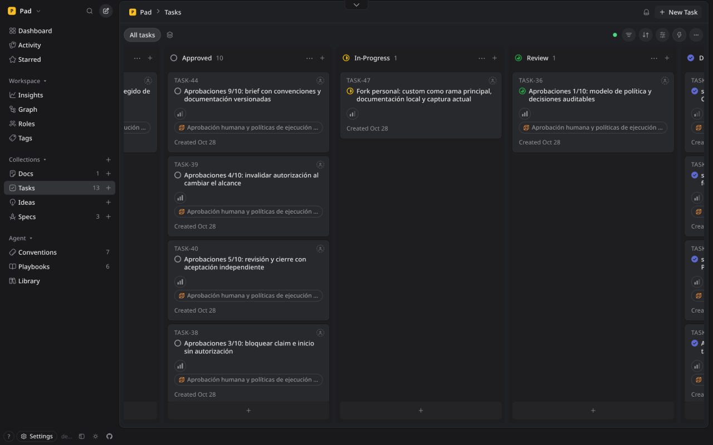

# Pad — fork personal de ga1az

Este repositorio es mi fork de [PerpetualSoftware/pad](https://github.com/PerpetualSoftware/pad), una herramienta de gestión de proyectos para personas y agentes de IA. Conserva la [licencia Apache 2.0](LICENSE) y el crédito al proyecto original. Para el catálogo completo de funciones, plataformas y despliegues, consulta la [documentación original](https://github.com/PerpetualSoftware/pad#readme).

La rama principal de este fork es **`custom`**. La rama **`main`** se conserva como referencia del upstream. La interfaz usa shadcn-svelte y una estética oscura inspirada en Linear. Incluye agentes por invitación (SPEC-15). Las políticas de aprobación están en desarrollo: **todavía no se aplican en `custom` ni en el servicio local**.



_Captura real del workspace Pad en la instancia local (`127.0.0.1:7777`), tomada el 28 de octubre de 2026. Las tareas de aprobación visibles corresponden a trabajo en desarrollo._

## Compilar y usar localmente

Necesitas Go **1.26.5** como mínimo, Node.js **24** (la versión usada en CI) y `make`. `go.mod` declara `toolchain go1.26.10`; Go puede conservar un toolchain instalado más nuevo. Para reproducir esa versión exacta, usa `GOTOOLCHAIN=go1.26.10`. Los scripts del frontend están en `web/package.json`.

```bash
git clone --branch custom https://github.com/ga1az/pad.git
cd pad
make build
./pad init
./pad server open
```

`make build` ejecuta `npm ci`, construye la web y el materializer, y genera `./pad` con esos recursos embebidos. `pad init` configura la conexión y el workspace desde el directorio del proyecto; puede iniciar el servidor local durante la configuración. `pad server open` abre la interfaz. Para iniciar el servidor en primer plano, usa `./pad server start`; sus valores por defecto son `127.0.0.1:7777`. Consulta `./pad server --help` para los comandos disponibles.

La instalación local usa `~/.pad` para datos, configuración y credenciales. No versiones esa carpeta ni sus secretos. El puerto `10000` de una instalación particular accesible mediante Tailscale no es el valor por defecto del proyecto.

`make install` instala o reemplaza el binario y reinicia el servidor local; úsalo solo cuando quieras desplegarlo. `make build-go` compila el backend sin reconstruir la web, pero requiere que `web/build` y `web/build-materializer/materializer.js` ya existan. Para desarrollo y pruebas, consulta [CONTRIBUTING.md](CONTRIBUTING.md).

## Ramas y contribuciones

Los cambios propios de este fork se proponen contra **`ga1az/pad:custom`**. Para contribuir al producto original, sigue las [instrucciones de PerpetualSoftware/pad](https://github.com/PerpetualSoftware/pad/blob/main/CONTRIBUTING.md). Una actualización requiere `git fetch upstream`, revisión de las diferencias y una integración explícita; nunca reemplaces `custom` automáticamente ni con un reset duro. Consulta [CONTRIBUTING.md](CONTRIBUTING.md) para el flujo de este fork.
